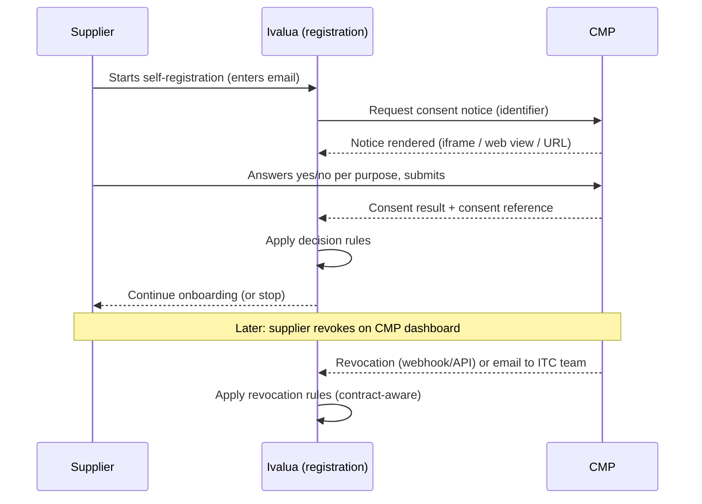

# ITC Hotels – DPDPA Supplier Consent in Ivalua via CMP
## Requirements Document

| Item | Detail |
|---|---|
| Client | ITC Hotels |
| Platform | Ivalua (ITC Hotels instance) |
| Related system | Consent Management Platform (CMP) – vendor to be confirmed |
| Prepared by | Srinivas K, Durvah IT Consulting |
| Version | 0.1 (draft, based on introductory call of 25 September 2026) |
| Status | Draft – for review by ITC Hotels |

> **Source tags used in this document**
> - **[Agreed]** – stated or agreed by ITC on the introductory call
> - **[Proposed]** – Durvah proposal or recommendation, to be confirmed by ITC
> - **[Open]** – not yet decided; see Section 13

---

## 1. Purpose

ITC Hotels must comply with the Digital Personal Data Protection Act, 2023 (DPDPA). ITC has started an internal DPDPA compliance project. As part of it, Ivalua, the platform used to onboard suppliers and run RFx events, must capture supplier consent **digitally**, through ITC's Consent Management Platform (CMP), **before** any personal data is recorded.

This document captures the requirements for that capability, for use as the basis of the Functional Design Document (FDD) and Integration Design Document (IDD).

## 2. Regulatory context

| Milestone | Date |
|---|---|
| DPDP Act enacted | August 2023 |
| DPDP Rules notified (Data Protection Board operational) | November 2025 |
| Consent Manager registration framework applicable | November 2026 |
| Substantive obligations (notice, consent, breach reporting, rights) apply | 14 May 2027 |

Implication: the supplier consent capability should be live in Ivalua well before **14 May 2027**, with time for the existing-supplier re-consent exercise.

> Note: legal interpretation (legal basis, purpose wording, retention) is for ITC legal to confirm. Durvah is not providing legal advice.

## 3. Scope

### 3.1 In scope
- Consent capture for suppliers at onboarding in Ivalua, via the CMP **[Agreed]**
- Digital consent for **all** suppliers: new and existing **[Agreed]**
- Supplier access to revoke or change consent through the CMP **[Agreed]**
- Handling of revocation in Ivalua (manual and/or automated) **[Agreed – method Open]**
- Linking Ivalua supplier records to CMP consent records via a unique identifier **[Agreed – identifier Open]**
- Privacy notice presentation to suppliers **[Proposed]**
- Retention, deletion and anonymization rules for supplier personal data **[Open – flagged as the main unsolved problem]**

### 3.2 Out of scope
- Consent capture in downstream systems (e.g. SAP) – only the front-end system that records data takes consent **[Agreed]**
- Design of consent notices and purposes – owned by ITC and configured on the CMP **[Agreed]**
- Guest consent on the ITC Hotels brand website and mobile app (separate workstream)
- Marketing consent – not applicable to suppliers **[Agreed]**

## 4. Stakeholders

| Stakeholder | Role |
|---|---|
| ITC Hotels – DPDPA compliance (Aditya) | Requirement owner; CMP programme lead |
| ITC Hotels – Procurement / Ivalua team | Process owner for supplier onboarding and sourcing |
| ITC Hotels – Legal / privacy | Legal basis, notice wording, retention, deletion rules |
| ITC Hotels – Vendor onboarding / finance teams | Operational handling of revocations (manual mode) |
| CMP vendor (TBC) | CMP platform, APIs, notice rendering, consent records |
| Ivalua | Platform configuration, API enablement, embedding support |
| Durvah IT Consulting | Ivalua solution design and integration build |

## 5. Current state

| Area | Current state |
|---|---|
| Integrations | All ITC Hotels Ivalua integrations are SFTP-based. Built by Durvah on its own integration platform. |
| API capability | Not enabled on the ITC Hotels instance (available on other ITC divisions' instances). Enabling it with certificate-based auth is a paid Ivalua activity, under discussion. |
| Existing consent | Declarations embedded in general T&C, with timestamp recorded in Ivalua. **Not acceptable** as DPDPA consent, since suppliers cannot exercise their rights digitally. |
| Data retention | Supplier data in Ivalua and related applications is never purged. |
| Downstream | Ivalua sends supplier data to SAP. |

## 6. Key concepts

- **CMP (Consent Management Platform):** a platform registered with the Data Protection Board that records consent and keeps an immutable copy as evidence for inquiries or litigation.
- **Data-blind CMP:** the CMP stores the consent answers and a hashed identifier, not the supplier's personal data.
- **Purpose:** each consent question relates to a specific purpose (e.g. retain data, invite to future sourcing events). Answers are yes or no per purpose.
- **Two vendor categories (legal basis):**
  1. **Vendors under an active contract or agreement:** processing is based on the contract; a privacy notice suffices; revocation does not affect the ongoing engagement.
  2. **Vendors with no active contract** (onboarded but not engaged, or contract ended): consent is the basis for holding and reusing their data.

## 7. Process overview

## 8. Functional requirements

### 8.1 Consent capture at onboarding

| ID | Requirement | Source |
|---|---|---|
| FR-01 | Ivalua shall present the CMP consent notice to a new supplier at onboarding, **before** any personal data (other than the identifier needed for consent) is recorded. | Agreed |
| FR-02 | The consent notice, purposes and questions shall be sourced from the CMP; Ivalua shall not hold its own copy of the notice text. | Agreed |
| FR-03 | The notice shall be displayed within the supplier registration flow via iframe, web view, or URL redirect, subject to Ivalua platform support. | Agreed (method Open) |
| FR-04 | The supplier shall be able to answer each purpose independently (yes or no) and submit. | Agreed |
| FR-05 | Consent shall be captured once, at onboarding. It shall not be requested at every login. | Agreed |
| FR-06 | Ivalua shall receive the consent outcome from the CMP (per purpose) and a CMP consent reference. | Agreed |
| FR-07 | Ivalua shall apply decision rules to the outcome (Section 9) to allow, restrict or stop onboarding. | Agreed (rules Open) |
| FR-08 | Buyer-initiated supplier invitations, where a buyer enters supplier contact data first, shall be covered by a defined consent approach. | Proposed |

### 8.2 Identification and linkage

| ID | Requirement | Source |
|---|---|---|
| FR-10 | Each consent record shall be linked to the supplier in Ivalua through a unique identifier shared with the CMP. | Agreed |
| FR-11 | The identifier shall be available at the start of registration. Recommended: supplier contact email (hashed SHA-256 by the CMP). Supplier code cannot be used, as it does not exist at consent time. | Proposed |
| FR-12 | Ivalua shall store the CMP consent reference ID in addition to the identifier, so linkage survives an email change. | Proposed |
| FR-13 | The linkage store (Ivalua database, or ITC on-premises mapping server) shall be decided. | Open |

### 8.3 Privacy notice

| ID | Requirement | Source |
|---|---|---|
| FR-20 | All suppliers shall be shown a privacy notice covering processing during an active engagement. | Agreed (privacy notice suffices for contracted vendors) |
| FR-21 | Whether the privacy notice is served from the CMP or from Ivalua shall be decided. | Open |

### 8.4 Supplier rights and revocation

| ID | Requirement | Source |
|---|---|---|
| FR-30 | The supplier portal shall provide a permanent "Manage consent" link to the CMP portal, where suppliers can view, change or revoke consent. | Agreed |
| FR-31 | The CMP shall authenticate the supplier on arrival (e.g. OTP to registered email), as the CMP is data-blind. | Proposed – to confirm with CMP vendor |
| FR-32 | On revocation, ITC shall be notified. Phase 1: email to the vendor onboarding / Ivalua team for manual update. Phase 2: automated update to Ivalua. | Agreed (both options), phasing Proposed |
| FR-33 | Revocation handling shall check the supplier's contract status (active contract, rate contract, open PO) before acting (Section 9.2). | Agreed |
| FR-34 | Revocation shall be handled at **contact** level where the supplier has multiple contacts, and at **supplier** level for sole proprietors / individuals. | Proposed |
| FR-35 | Ivalua shall support a "dormant" or equivalent status that excludes a supplier or contact from new sourcing events and new orders, while keeping in-flight transactions. | Agreed |

### 8.5 Existing suppliers

| ID | Requirement | Source |
|---|---|---|
| FR-40 | Existing onboarded suppliers shall give digital consent through the CMP. | Agreed |
| FR-41 | A re-consent mechanism shall be defined: prompt at next portal login and/or CMP-driven email campaign. | Proposed |
| FR-42 | Treatment of existing suppliers who do not respond by a cut-off date shall be defined. | Open |

### 8.6 Retention, deletion and anonymization

| ID | Requirement | Source |
|---|---|---|
| FR-50 | A deletion request from a vendor under an active contract shall be deferred until contract end plus the statutory retention period, with a response to the vendor explaining this. | Agreed |
| FR-51 | A deletion request from a vendor never engaged (no contract, no transactions) shall be honoured. | Agreed |
| FR-52 | At contract end, suppliers without future-use consent shall move to "retention only" status, excluded from sourcing, and be purged or anonymized after the retention period. | Proposed |
| FR-53 | Deletion shall be implemented as anonymization of personal fields (contact name, email, phone, individual IDs, individual bank details), preserving transactional records (POs, invoices, contracts, audit trail). | Proposed – subject to Ivalua capability |
| FR-54 | Erasure shall extend to personal data replicated to the SAP vendor master. | Proposed |
| FR-55 | The retention period shall be defined by ITC legal. | Open |

## 9. Business rules

### 9.1 Consent outcome at onboarding

Illustrative purposes, based on the call. Final purposes are to be defined by ITC legal on the CMP.

| Purpose (illustrative) | Type | If declined |
|---|---|---|
| P1 – Process and retain personal data for supplier registration and engagement | Mandatory (or covered by privacy notice – TBC) | Onboarding cannot proceed (TBC) |
| P2 – Retain data after contract end and invite to future sourcing events | Optional | Onboard; exclude from future sourcing after contract end; purge after retention period |

### 9.2 Revocation (contract-aware)

| Supplier situation | Action on revocation |
|---|---|
| Active contract, rate contract or open PO/invoice | Record revocation; continue current engagement; exclude from new sourcing and renewals; purge after contract end + retention |
| Onboarded, never engaged | Mark dormant; honour deletion if requested |
| Contract ended | Exclude from sourcing; retention-only; purge after retention period |

## 10. Integration requirements

| ID | Requirement | Source |
|---|---|---|
| IR-01 | Outbound: Ivalua shall call the CMP to initiate consent (API or URL) and render the notice. | Agreed |
| IR-02 | Return path: Ivalua shall receive the consent result, via API response, redirect/callback with consent reference, or CMP push. | Agreed (method Open) |
| IR-03 | Inbound: the CMP shall notify Ivalua of revocations and preference changes (webhook/API), or via a scheduled SFTP file as an interim option. | Proposed |
| IR-04 | Authentication shall follow the CMP vendor's specification; certificate-based auth depends on Ivalua API enablement. | Open |
| IR-05 | Integration shall be built by Durvah on its integration platform. | Agreed |
| IR-06 | No consent-related integration is required to SAP. | Agreed |

### 10.1 Integration options against current constraints

| Option | Needs Ivalua API enablement | Real-time result | Notes |
|---|---|---|---|
| A. API call + embedded notice (iframe / web view) | Yes | Yes | ITC's stated preferred model |
| B. URL redirect to CMP-hosted page with callback | No (for outbound) | Depends on callback | Possible path before API enablement, if the CMP supports it |
| C. Native capture in Ivalua + SFTP sync to CMP | No | No | Weakens CMP-as-original-record; likely not acceptable to ITC |

## 11. Data requirements (Ivalua side)

| Field | Level | Notes |
|---|---|---|
| CMP consent reference ID | Contact / supplier | Returned by CMP |
| Identifier used with CMP | Contact | Email (hash held by CMP) |
| Consent status per purpose | Contact / supplier | Yes / No / Revoked |
| Consent date / last changed date | Contact / supplier | From CMP |
| Notice version | Contact / supplier | If provided by CMP |
| Consent-driven status | Supplier / contact | Active / Restricted / Dormant / Retention-only |

## 12. Non-functional requirements

| ID | Requirement |
|---|---|
| NFR-01 | Consent evidence is held in the CMP as the system of record; Ivalua holds references only. |
| NFR-02 | The consent step shall not add significant delay to supplier registration. |
| NFR-03 | Failure handling: if the CMP is unavailable, registration shall not proceed without consent; the supplier shall see a clear message and retry option. |
| NFR-04 | All consent and revocation events in Ivalua shall be auditable (who, what, when). |
| NFR-05 | Communication with the CMP shall be encrypted and authenticated per ITC security standards. |

## 13. Open questions

| # | Question | Owner |
|---|---|---|
| 1 | When will API enablement (certificate-based auth) on the ITC Hotels instance be agreed with Ivalua, and at what cost? | ITC with Ivalua |
| 2 | Does Ivalua support embedding an external CMP notice (iframe / web view) in supplier registration? | Durvah with Ivalua |
| 3 | Does the CMP support a hosted consent page with redirect/callback URL? | CMP vendor |
| 4 | Which identifier and linkage store will be used? | ITC, Durvah, CMP vendor |
| 5 | Final purposes and notice wording. Is "future unknown purpose" acceptable under DPDPA's specified-purpose requirement? | ITC legal |
| 6 | Legal basis for contracted vendors without consent (DPDPA has no general contract ground; Section 7 legitimate uses to be assessed). | ITC legal |
| 7 | Which purposes are mandatory for onboarding? | ITC legal and procurement |
| 8 | Retention period after contract end. | ITC legal |
| 9 | Does Ivalua support anonymization of supplier contact personal data? SAP vendor master approach? | Durvah, Ivalua, ITC SAP team |
| 10 | Re-consent approach, cut-off and treatment of non-responders among existing suppliers. | ITC and Durvah |
| 11 | How does the CMP push revocations (webhook vs polling vs file)? | CMP vendor |
| 12 | Which CMP vendor is being contracted? | ITC |

## 14. Dependencies and assumptions

**Dependencies**
- CMP vendor contract signed (expected week of 28 September 2026)
- CMP integration approach and API document from ITC
- Ivalua API enablement decision (paid)
- ITC legal decisions on purposes, legal basis and retention

**Assumptions**
- The CMP provides APIs and/or a hosted consent page suitable for Ivalua supplier registration.
- The CMP vendor will support the technical design, based on its implementations for large Indian banks.
- Durvah builds and maintains the integration on its own integration platform.

## 15. Proposed phasing

| Phase | Scope |
|---|---|
| Phase 1 | Consent capture at onboarding (Option A or B); Manage consent link; manual revocation handling via email to ITC team; privacy notice |
| Phase 2 | Automated revocation update to Ivalua; contract-aware status automation; re-consent campaign for existing suppliers |
| Phase 3 | Retention and anonymization rules in Ivalua and SAP |

Target: Phases 1 and 2 live before **14 May 2027**.
